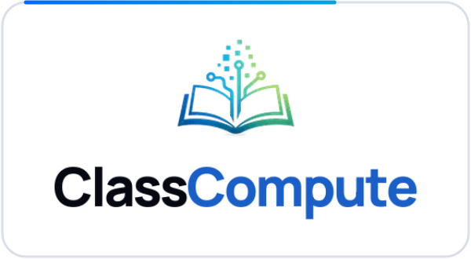
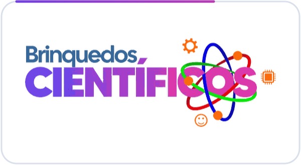
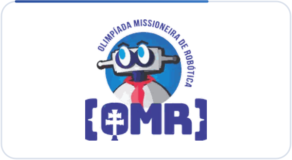

### Oi, eu sou o Lorenzo! 👋

- 👀 Dá uma olhada na [ClassCompute](https://classcompute.com.br), meu TCC que virou app
- 🌱 Aprendendo um pouco de tudo, principalmente IA
- 💬 Trabalho com suporte numa empresa de hospedagem
- 🤖 Se dá pra automatizar, automatizo
- 📍 Santo Ângelo, RS
- ⚡ Curiosidade: gosto de robótica

**Me encontra por aí:**

 

<table>
<tr>
<td align="center" valign="top" width="33%">

<h3>ClassCompute</h3>
Aula de computação pronta, ligada à BNCC
  

  
<a href="https://classcompute.com.br">Site</a> · <a href="https://app.classcompute.com.br">App</a>
</td>
<td align="center" valign="top" width="33%">

<h3>Brinquedos Científicos</h3>
Site e painel do projeto da URI
  

  
<a href="https://bc.san.uri.br">Site</a> · <a href="https://github.com/lorenzcalle/site-brinquedos">Código</a>
</td>
<td align="center" valign="top" width="33%">

<h3>OMR</h3>
Olimpíada Missioneira de Robótica
  

  
<a href="https://omr.san.uri.br">Site</a>
</td>
</tr>
</table>

 

### 🛠️ Ferramentas

   

